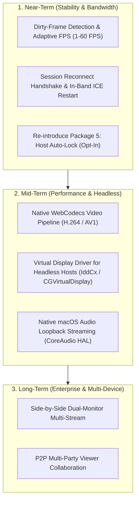

# Remote Desktop Engineering Compendium: Architecture, Learnings, Issues & Roadmap

> **Authoritative Technical Reference for Developers and AI Agents**  
> **Subsystem**: Remote Desktop (Native OS Bridge `bridge.py`, Host Controller `host-controller.js`, Client Viewer `ui-controller.js`, WebRTC Engine `webrtc-core.js`)  
> **Repository**: [webrtc-p2p](https://github.com/Mahesh-Devani/webrtc-p2p)  
> **Last Updated**: November 1, 2026  

---

## 1. Executive Summary & Evolution

The **P2P Connect Remote Desktop** subsystem was conceived to provide a 100% serverless, zero-backend, high-performance remote access tool capable of matching or exceeding proprietary commercial solutions like **Google Chrome Remote Desktop**, **AnyDesk**, and **TeamViewer**, while strictly adhering to the project's zero-build, browser-native ES module architecture.

```text
                               ┌───────────────────────────────────────────────┐
                               │           NOSTR RELAYS (NIP-44 v2)            │
                               │   wss://relay.primal.net, nos.lol, offchain   │
                               └───────────────────────▲───────────────────────┘
                                                       │
                                   Encrypted Signaling │ Handshake (kind 24133)
                                                       ▼
┌───────────────────────────────────────┐            WebRTC            ┌───────────────────────────────────────┐
│          REMOTE CLIENT VIEWER         │◄────────────────────────────►│           REMOTE HOST SYSTEM          │
│   (index.html / ui-controller.js)     │  DataChannels + MediaStream  │      (host.html / host-controller)    │
│                                       │                              │                                       │
│  - 60 FPS Video Pipeline & HUD        │                              │  - Canvas Stream Engine               │
│  - Virtual Trackpad / Direct Touch    │                              │  - Video Quality Governor (12 Mbps)   │
│  - Soft Modifiers & Mobile Keyboard   │                              │  - Idle Display Sleep Shield          │
│  - Monitor & Window Target Picker     │                              └───────────────────▲───────────────────┘
│  - Bidirectional Clipboard Sync       │                                                  │ WebSocket Loopback
└───────────────────────────────────────┘                                                  │ (ws://127.0.0.1:9999)
                                                                                           ▼
                                                                       ┌───────────────────────────────────────┐
                                                                       │       NATIVE OS BRIDGE (bridge.py)    │
                                                                       │                                       │
                                                                       │  - CoreGraphics / Win32 Capture       │
                                                                       │  - ImageIO Hardware JPEG Encoder      │
                                                                       │  - DisplayWakeManager (caffeinate)    │
                                                                       │  - Native Input Injection & Clipboard │
                                                                       └───────────────────────────────────────┘
```

The system operates across two distinct modes:
1. **Mode 1: Enhanced Native Mode (`bridge.py` active)**:
   - Zero-gesture unattended remote start via offscreen canvas `captureStream()`.
   - Hardware-accelerated display and application window capture (macOS CoreGraphics / Windows Win32 GDI+).
   - Zero permanent power drain: host display sleeps and locks naturally when unattended, waking on-demand via `caffeinate -d -u` and IOKit assertions upon remote connection.
   - Remote lock screen authentication: users can view the macOS/Windows login prompt and securely unlock the machine.
   - Dynamic target switching: remote clients can enumerate and switch between physical monitors or specific open application windows on the fly.
2. **Mode 2: Legacy Browser View-Only Fallback (`bridge.py` offline)**:
   - 100% browser-native fallback using standard `navigator.mediaDevices.getDisplayMedia()`.
   - Requires manual local click on the host; provides real-time view-only streaming if the native bridge is not installed or running.

---

## 2. Where We Stand vs. Initial Plan

| Initial Roadmap Deliverable | Target Specification | Current Status | Implementation & Architectural Details |
|---|---|---|---|
| **Package 1: Audio Controls & Performance Diagnostics HUD** | Live RTT, FPS, bitrate HUD pill; in-stream audio controls. | ✅ **Completed** | Implemented via `pc.getStats()` poller in `ui-controller.js` (`startPerfHudStats()`). In-stream audio slider with auto-mute fallback. |
| **Package 2: Mobile Touch Engine & Soft Modifier Bar** | Direct touch, virtual trackpad with left/right click, soft modifier bar (`[Esc] [Tab] [Ctrl] [Alt] [Win] [⌨️]`). | ✅ **Completed** | Implemented in `ui-controller.js`. Dual-mode touch toggle, aspect-ratio-corrected virtual trackpad (`getVideoActualDimensions()`), and hidden input for native keyboard triggering. |
| **Package 3: Live Host Status in Sidebar** | Real-time status badges (`🟢 Online`, `🟡 Standby`, `⚠️ Blocked`, `🔴 Offline`) on saved computer cards. | ✅ **Completed** | Implemented via `host_ping` ↔ `host_pong` encrypted Nostr heartbeats with reachability caching in `localStorage`. |
| **Package 4: Display Quality Presets & 1:1 Pixel Mapping** | `15M / 30fps` Crisp, `8M / 60fps` Balanced, `2M / 30fps` Low; 1:1 unscaled pixel mapping with panning. | ✅ **Completed** | Implemented via `peerSession.setVideoQuality()` and CSS class `.rd-fit-native` with drag-to-pan in `ui-controller.js`. |
| **Package 5: Host Auto-Lock on Disconnect** | Automatically lock host OS (`SACLockScreenImmediate` / `LockWorkStation` / `loginctl`) on remote disconnect. | ✅ **Completed** | Implemented as opt-in toggle on `host.html` (`p2p-host-auto-lock`). Disconnect triggers native OS screen lock via bridge or fallback commands. |
| **Package 6: Saved Computer Management & Deep Links** | Persistent computer fleet, PIN verification, client whitelist, 1-click reachability, URL deep links. | ✅ **Completed** | Full fleet manager in `index.html`. AES-GCM encrypted fleet export/import. URL deep links support `#pin=` and `?remoteHost=`. |
| **Package 7: Core Connection Engine & Invariant Shield** | Transceiver negotiation, `a=msid` stream binding, key isolation, automated regression test suite. | ✅ **Completed** | 12 architectural invariants (`check-invariants.py`) and 93 zero-token automated tests (`run-regressions.py`). |
| **Package 8: Remote Clipboard Synchronization** | Bidirectional clipboard sync between client and host; auto-sync on Ctrl+V / Cmd+V. | ✅ **Completed** | Implemented via DataChannel `p2p-input` (`evt.t === 'clipboard'`) and bridge native clipboard commands (`pbcopy`/`pbpaste`, `clip`, `xclip`). |
| **Native On-Demand Capture & Wake Engine** | Zero energy waste display sleep, on-demand wake, lock-screen remote login, zero pip dependencies. | ✅ **Completed** | `DisplayWakeManager` and `NativeFrameCapturer` in `bridge.py`. ImageIO JPEG compression (0.85 quality), offscreen canvas stream in `host-controller.js`. |
| **Adaptive FPS & Dirty-Frame Detection** | Throttle capture rate when screen is static to save CPU/bandwidth; burst to 60 FPS on activity. | ✅ **Completed** | `zlib.crc32` dirty-frame check in `bridge.py`. Drops to 2 FPS when idle > 2s with periodic 1s heartbeats; bursts to 60 FPS on input/changes. |
| **In-Band WebRTC ICE Restart** | Auto-recover media stream when network IP/route changes without tearing down session. | ✅ **Completed** | `session.restartIce()` on `PeerSession` via `p2p-sig` DataChannel (`iceRestart: true`), wired into UI reconnect banner. |
| **Mobile 1-Finger & 2-Finger Page Scroll** | Fluid page scrolling on mobile devices without conflicting with 2-finger zoom. | ✅ **Completed** | Dedicated `[↕️ Scroll]` toggle on soft keys bar, fractional wheel accumulator in `bridge.py` (8px threshold), and pinch vs scroll detection. |
| **Extended UX B: Last Connected & Duration** | Display "Connected 15m ago (Duration: 42m)" on computer cards. | ✅ **Completed** | Automatically recorded in `p2p-remote-devices` upon session teardown. |
| **Extended UX C: Multi-Monitor & Window Switcher** | Switch between physical monitors and individual application windows. | ✅ **Completed** | Dynamic target enumeration via `get_targets` and switching via `select_target` over `p2p-input`. |
| **Extended UX D: Encrypted Fleet Export/Import** | Export/import saved computers with optional PBKDF2 / AES-256-GCM encryption. | ✅ **Completed** | Full JSON export/import modal with password encryption. |
| **Extended UX E: 24/7 Power & Sleep Guidance** | Interactive modal explaining OS power settings for unattended access. | ✅ **Completed** | Accessible directly from the Reachability box on computer cards. |
| **Extended UX F: Transient Disconnect Auto-Resume** | In-stream auto-resume banner with countdown when network blips. | ✅ **Completed** | 4-second transient disconnect banner with automatic Nostr reconnection. |

---

## 3. Deep-Dive: Root Causes & Lessons Learned

Across our development and real-world field testing (including multi-hour production sessions between Windows laptops and Apple Silicon Mac Studio with 32:9 ultrawide displays), we encountered and resolved critical edge cases. These are categorized below for developers and AI agents:

### Category A: Native OS Subsystem & Low-Level Hardware (macOS & Windows)

#### 1. 64-bit Pointer Truncation on ARM64 Apple Silicon (INV-11 / Bridge Stability)
- **Symptom**: `bridge.py` crashed immediately with `Segmentation fault: 11 (EXC_BAD_ACCESS)` as soon as `enumerate_targets()` or `map_client_coords()` was called on macOS.
- **Root Cause**: Python's `ctypes` library defaults function return values (`restype`) to a 32-bit `c_int`. On 64-bit macOS architectures (Apple Silicon M1/M2/M3/M4 and x86_64), CoreFoundation and CoreGraphics pointer addresses reside in high 64-bit memory regions (e.g., `0x10501c1c0`). Without an explicit `restype = ctypes.c_void_p`, pointers were truncated to 32 bits (`0x501c1c0`), crashing when passed to `CFArrayGetCount` or `CFRelease`.
- **Lesson / Rule**: **Every single ctypes binding** interacting with CoreFoundation, CoreGraphics, or Win32 MUST declare explicit `restype = ctypes.c_void_p` and explicit `argtypes`.

#### 2. IOKit Power Assertion Token Idempotency & WindowServer Deadlock
- **Symptom**: After several target switches or reconnects, the Mac Studio display would fail to wake, or mouse and keyboard HID input would freeze entirely.
- **Root Cause**: The bridge initially used a raw integer counter (`self._assertion_count += 1 / -= 1`) for `IOPMAssertionCreateWithName(kIOPMAssertionTypePreventUserIdleDisplaySleep)`. Rapid target switching or reconnects leaked counter increments. Holding display sleep assertions indefinitely while high-refresh external monitors (e.g., Samsung Odyssey DP/HDMI link renegotiation / CEC wake) cycled power caused WindowServer / SkyLight display link renegotiation deadlocks on Apple Silicon, locking up the WindowServer event tap thread.
- **Lesson / Rule**: Never use raw counters for system power assertions. Use a token-based set (`self._active_tokens = set()`), enforce token idempotency across target switches, and guarantee unconditional teardown on `release(force=True)`.

#### 3. The macOS `loginwindow` Idle Override & Blank Lock Screen
- **Symptom**: When macOS locked, mouse movement was received by the OS (the cursor moved), but the remote video stream stayed completely black or asleep.
- **Root Cause**: When a macOS user session locks, the system transfers display power management to the `loginwindow` process. `loginwindow` ignores standard `IOPMAssertionCreateWithName` user idle sleep assertions created by user-space applications! Consequently, the physical display panel power drops to DPMS off / sleep mode, causing `CGDisplayCreateImage()` to capture pure black frames.
- **Lesson / Rule**:
  1. Manage a continuous `caffeinate -d -u` background process spawned by the bridge while a remote session is active.
  2. Synthesize an immediate ±1px cursor nudge via Quartz `CGEventCreateMouseEvent(None, kCGEventMouseMoved, ...)` to transition WindowServer out of low-power sleep.
  3. Ensure `host-controller.js` invokes `nativeCanvasTrack.requestFrame()` after drawing bitmaps to the offscreen canvas.

#### 4. The Erroneous Frame Size Filter in Native Frame Capture
- **Symptom**: Stream appeared frozen or completely blank specifically on the lock screen, even though `caffeinate` was running.
- **Root Cause**: An early optimization attempt in `bridge.py` checked `if is_locked and len(jpeg_bytes) < 200000: continue`, assuming any frame smaller than 200 KB represented a black/empty display. However, hardware JPEG compression (DCT) on dark lock screens or simple wallpapers compresses a 5120x1440 image down to ~116 KB! The filter ended up dropping 100% of valid lock screen frames, starving the WebRTC video pipeline.
- **Lesson / Rule**: Never drop captured frames based on arbitrary payload size heuristics. Stream all captured frames to the canvas; let the video encoder and client display the actual screen state.

#### 5. WindowServer IPC Saturation from Unthrottled Status Queries (INV-11)
- **Symptom**: Host CPU usage spiked to 100%, and mouse cursor tracking stuttered under high-frequency movement.
- **Root Cause**: Native OS queries like `CGSessionCopyCurrentDictionary()` (checking if screen is locked) and `CGWindowListCopyWindowInfo()` (fetching window geometry) execute synchronous Mach IPC calls to `WindowServer`. Calling these inside 60 FPS capture loops or 120 Hz cursor mapping saturated the WindowServer IPC queue.
- **Lesson / Rule**: Enforce strict monotonic clock caching (`time.monotonic()`, TTL 1.0–1.5s) for all OS status and window geometry queries.

---

### Category B: WebRTC Signaling, Transport & Lifecycle Stability

#### 6. Destructive Replayed Offer Acceptance on Nostr Relay Reconnection
- **Symptom**: Active remote desktop sessions randomly dropped and disconnected after 1–5 minutes of active use.
- **Root Cause**: When a public Nostr relay (such as `nos.lol` or `relay.primal.net`) experienced a transient TCP reset, `NostrTransport` automatically reconnected and called `_resubscribeAll()`. Nostr relays immediately replayed all stored events from the last 60 seconds matching the subscription filter.
  In `host-controller.js`, the offer handler only checked `if (activeSession && activeSessionId === sessionId) return;`.
  If an earlier retry offer arrived with a different `sessionId`, the host executed:
  ```javascript
  if (activeSession) {
    try { activeSession.close({ stopTracks: false }); } catch {}
  }
  ```
  This immediately closed `pc` and `dcChat`, sending an SCTP abort to the client, which fired `onChannelClose` and killed the active remote desktop session!
- **Lesson / Rule**: An incoming signaling offer must **never** destroy an already healthy, active session. The guard must check:
  ```javascript
  if (activeSession && (activeSessionId === sessionId || activeSession.getState() === 'connected' || activeSession.isChannelOpen())) {
    return; // Ignore incoming offer; session is already healthy
  }
  ```

#### 7. Unshielded `visibilitychange` Forcing Transport Reconnects
- **Symptom**: Unlocking the host Mac or switching browser tabs immediately disconnected the client.
- **Root Cause**: `host-controller.js` had a `visibilitychange` listener calling `NostrTransport.ensureConnected()` without checking `!activeSession`. Whenever the host tab gained visibility, it forced relay reconnection, which triggered replayed offers and executed the destructive close bug described above.
- **Lesson / Rule**: Shield all background reconnect calls with `if (!activeSession)`. While P2P WebRTC is active, external signaling relays are idle and must not be aggressively reconnected.

#### 8. Video Track Churn and Bitrate Reset on Canvas Resize
- **Symptom**: Switching between displays or application windows caused video quality to plummet into pixelated blur, occasionally dropping the call.
- **Root Cause**: In `host-controller.js`, whenever canvas dimensions changed, the code called:
  ```javascript
  nativeCanvasStream = nativeCanvas.captureStream(30);
  activeSession.addLocalStream(nativeCanvasStream);
  ```
  In browser WebRTC, `HTMLCanvasElement.captureStream()` dynamically adapts to changes in `canvas.width` and `canvas.height` without needing a new track. Calling `captureStream()` repeatedly orphaned old tracks, triggered `replaceTrack()`, reset Chromium's hardware VideoToolbox encoder to the browser default bitrate (~1.5 Mbps), and triggered transient renegotiation drops.
- **Lesson / Rule**: Initialize `canvas.captureStream()` exactly once. Dynamic dimension changes scale the existing canvas track automatically. Always re-apply `setVideoQuality(12_000_000, 60)` whenever local media streams are configured.

#### 9. Cryptographic Identity Glare (`p2p-host-*` vs `nostr-*`)
- **Symptom**: Testing host and client on the same device or browser profile produced connection collisions and instant disconnects.
- **Root Cause**: Both sides read and wrote to the same `localStorage` key (`nostr-privkey`), causing the host to attempt a WebRTC handshake with itself.
- **Lesson / Rule (INV-3)**: Maintain strict storage key separation. Host keys reside in `p2p-host-privkey` / `p2p-host-pubkey`; client keys reside in `nostr-privkey` / `nostr-pubkey`.

---

### Category C: Aspect Ratio, Input Mapping & Mobile UX

#### 10. Ultrawide Aspect Ratio (32:9) Stream Downscaling Distortion (INV-12)
- **Symptom**: On a 5120x1440 ultrawide monitor, text was fuzzy and unreadable, and vertical resolution was severely degraded.
- **Root Cause**: Legacy code assumed a 16:9 aspect ratio and clamped canvas streaming to `MAX_STREAM_WIDTH = 2560`. On a 32:9 display, clamping width to 2560 forced vertical resolution down to `2560 * 9 / 32 = 720p`!
- **Lesson / Rule**: Scale canvas bounds to `MAX_STREAM_WIDTH = 3840` and `MAX_STREAM_HEIGHT = 2160`. This allows a 5120x1440 monitor to stream at 3840x1080 (full 1080p vertical clarity) with crisp text.

#### 11. Virtual Trackpad Vertical Movement Skew on Ultrawide Streams
- **Symptom**: In mobile Trackpad mode, horizontal cursor movement was normal, but vertical movement was extremely sluggish and required dozens of swipes.
- **Root Cause**: The trackpad delta mapping normalized touch coordinates against the outer video container dimensions (`clientWidth` / `clientHeight`). On ultrawide displays, the video container has large black letterbox bars on top and bottom. Normalizing against the container distorted the vertical scaling factor.
- **Lesson / Rule**: Calculate the actual rendered video rect inside the container via `getVideoActualDimensions()` and normalize delta movements strictly against the active video pixels.

#### 12. macOS Spaces (Virtual Desktops) WindowServer Limitation
- **Symptom**: User asked if background Spaces (e.g. Space 2 while working on Space 1) can be shared in a remote desktop session.
- **Root Cause**: The macOS WindowServer architecture does not composite or render background Mission Control Spaces into hardware display buffers. `CGDisplayCreateImage()` captures only the currently active Space.
- **Lesson / Rule**: Educate users and leverage Window Capture (`CGWindowListCreateImage`). macOS maintains off-screen backing stores for individual application windows regardless of which Space they reside on. By selecting a window target from the toolbar, the client can view and control an application running on Space 2 without switching the host's active desktop!

---

## 4. Architectural Invariants Enforced in Code

The repository enforces 12 immutable architectural invariants via `check-invariants.py` and `tests/test_invariants.py`:

| Invariant | Enforced Rule | Verification Mechanism |
|---|---|---|
| **INV-1** | No query parameters on internal ES module imports (prevents splitting stateful singletons). | AST & regex scan across all `.js` files. |
| **INV-2** | Consistent singleton import paths across modules. | Strict path matching in import declarations. |
| **INV-3** | Storage key isolation (`p2p-host-*` vs `nostr-*`). | Key prefix inspection across host and client code. |
| **INV-4** | `addLocalStream` must pass parent stream to `pc.addTrack(track, stream)` for `a=msid`. | AST validation of WebRTC track association. |
| **INV-5** | DataChannel file protocol markers (`_fileStart`, `_fileEnd`, `_fileAbort`, backpressure drain). | Verification of SCTP flow control and drain loops. |
| **INV-6** | Cache busters allowed ONLY on root HTML script tags (`index.html`, `host.html`). | Scan forbidding query parameters on internal module imports. |
| **INV-7** | Zero JavaScript syntax errors via Tree-sitter AST parser. | Full AST syntax parse of every JS file in project. |
| **INV-8** | Host rejects connection offers when desktop capture is inactive. | Verification of `isHostStreamLive()` gate in `host-controller.js`. |
| **INV-9** | Nostr signal types strictly whitelisted. | Array containment check in `nostr-transport.js`. |
| **INV-10** | Signaling idempotency: shielded heartbeats (`!activeSession`) & duplicate offer rejection. | AST checks for shielded keepalives and active session guards. |
| **INV-11** | Zero unthrottled OS IPC in capture/input loops (`max_age` monotonic clock caching). | Verification of `time.monotonic()` caching in `bridge.py`. |
| **INV-12** | Remote desktop aspect ratio supports ultrawide 3840x2160, 12 Mbps, and 0.85 JPEG. | Constant verification across `host-controller.js` and `bridge.py`. |

---

## 5. Future Roadmap & Proposed Improvements

Based on comprehensive system analysis, the following high-impact enhancements are planned:



### 1. Dirty-Frame Detection & Adaptive FPS (Near-Term)
- **Goal**: Slash host CPU and network bandwidth during static desktop viewing.
- **Architecture**: In `bridge.py` `stream_frames_loop()`, compute a fast 64-bit perceptual hash or sub-sampled tile diff between consecutive captured frames.
- **Behavior**: Drop capture rate to 1 FPS when the desktop is static; burst to 30–60 FPS immediately upon detecting user input or screen changes.

### 2. In-Band WebRTC ICE Restart (Near-Term)
- **Goal**: Seamless network switching without dropping remote desktop session state.
- **Architecture**: When a client transitions between Wi-Fi and mobile data, invoke `pc.createOffer({ iceRestart: true })` over DataChannel `p2p-sig` or Nostr transport, preserving active UI overlays, control state, and buffers.

### 3. Re-introduce Package 5: Host Auto-Lock on Disconnect (Near-Term)
- **Goal**: Enhance physical security for unattended workstations.
- **Architecture**: Add an opt-in toggle on `host.html`: *"Lock host screen when remote controller disconnects"*. Upon session termination, `bridge.py` invokes `/System/Library/CoreServices/Menu\ Extras/User.menu/Contents/Resources/CGSession -suspend` (macOS) or `LockWorkStation()` (Windows).

### 4. Native WebCodecs H.264 / AV1 Pipeline (Mid-Term)
- **Goal**: Achieve ultra-low glass-to-glass latency (< 20ms) and eliminate canvas overhead.
- **Architecture**:
  - In `bridge.py`, encode captured display frames directly to H.264 NALUs via macOS `VideoToolbox` (`VTCompressionSession`) or Windows NVENC / AMF.
  - Stream compressed NALUs over a dedicated binary DataChannel.
  - Decode directly into an `HTMLVideoElement` using the browser's `WebCodecs` `VideoDecoder`, bypassing the intermediate canvas and browser WebRTC encoder stack entirely.

### 5. Virtual Display Emulation for Headless Hosts (Mid-Term)
- **Goal**: Enable full-resolution remote desktop for headless servers (e.g. Mac mini or cloud workstations without a physical display plugged in).
- **Architecture**: Integrate a virtual display driver helper (such as macOS `CGVirtualDisplay` CoreGraphics private framework or Windows Indirect Display Driver `IddCx`) to create high-resolution virtual monitors (e.g. 4K / 1440p) dynamically on demand.

### 6. Native macOS Audio Loopback Streaming (Mid-Term)
- **Goal**: Stream host system audio in Mode 1 (Native Bridge mode).
- **Architecture**: Utilize macOS CoreAudio HAL process tap or ScreenCaptureKit audio engine in Python to capture system audio and pipe it to a WebRTC audio transceiver.

---

## 6. Guide for AI Agents Working on This Codebase

When tasked with debugging or enhancing the Remote Desktop subsystem, AI agents **MUST** adhere to the following protocol:

1. **Check Invariants First**: Run `python3 check-invariants.py`. Never proceed if any of the 12 invariants are broken.
2. **Run Change-Aware Regressions**: Run `python3 run-regressions.py` before and after every code change. Ensure all 93 tests pass.
3. **Preserve Singleton Purity (INV-1 & INV-6)**: Never add query parameters or version tags to internal ES imports. Only root script tags in `index.html` and `host.html` carry cache busters (`?v=XX`).
4. **Never Bypass Storage Key Isolation (INV-3)**: Host keys must always use `p2p-host-*`; client keys must always use `nostr-*`.
5. **Protect Connected Sessions (INV-10)**: Never allow incoming Nostr signaling offers to tear down an active, healthy session.
6. **Keep Knowledge Graph Fresh**: Always run `graphify update .` after adding or editing files in the repository.
